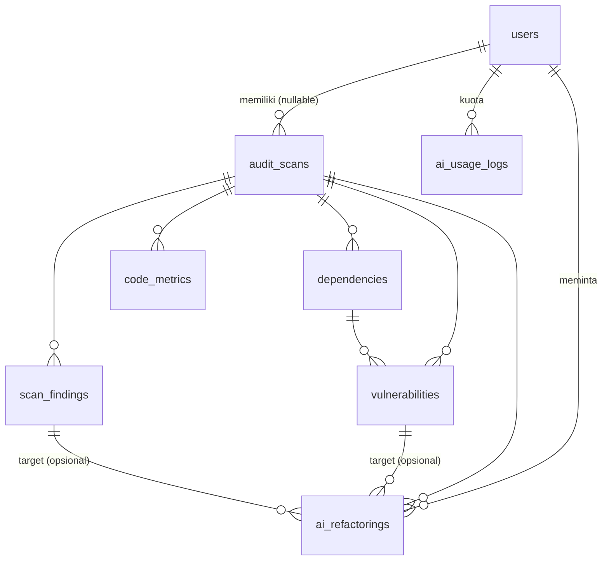

# DATABASE — Rancangan Skema MySQL

> Status dokumen: **DRAFT — WAJIB disetujui sebelum migration pertama dibuat.**
> Engine: InnoDB · Charset: `utf8mb4` · Collation: `utf8mb4_unicode_ci`

## 1. Prinsip Desain

- Setiap jenis hasil audit punya tabel sendiri (tidak dicampur dalam satu tabel/JSON besar).
- Semua tabel hasil terhubung ke satu `audit_scans.id` dengan `ON DELETE CASCADE`.
- Primary key internal `BIGINT UNSIGNED` auto-increment; ID publik audit memakai **ULID** (`public_id`) agar tidak bisa ditebak dan tidak membocorkan jumlah audit.
- Enum disimpan sebagai `VARCHAR` + PHP Enum (Laravel cast), bukan `ENUM` MySQL, agar penambahan nilai tidak butuh `ALTER TABLE` berisiko. Daftar nilai tetap didokumentasikan di bawah.
- Kolom JSON hanya untuk data pendukung yang tidak dipakai untuk filter (alias, referensi, metadata mentah).
- IP guest **tidak** disimpan mentah.

## 2. Ringkasan Tabel

| # | Tabel | Tujuan | Pemilik |
|---|---|---|---|
| 1 | `users` | Akun Google | Raihan |
| 2 | `audit_scans` | Sesi audit (pusat relasi) | Bersama |
| 3 | `scan_findings` | Temuan SAST ternormalisasi | Raihan |
| 4 | `code_metrics` | Metrik kualitas per file/fungsi | Raihan |
| 5 | `dependencies` | Komponen npm hasil ekstraksi | Yuki |
| 6 | `vulnerabilities` | Kecocokan advisori OSV ↔ dependency | Yuki |
| 7 | `ai_refactorings` | Hasil AI remediation / fallback | Annisa |
| 8 | `ai_usage_logs` | Penghitung pemakaian AI harian (kuota) | Annisa |
| — | `failed_jobs` | Bawaan Laravel, job yang gagal | Framework |

### Tabel yang tidak dibuat (beserta alasan)

| Tabel | Alasan tidak dibuat |
|---|---|
| `password_reset_tokens` | Tidak ada login password; hanya Google OAuth. |
| `sessions` | Usulan: session driver Redis (lihat D-07). Dibuat hanya jika tim memilih driver `database`. |
| `jobs`, `job_batches` | Queue memakai Redis, bukan database. |
| `cache`, `cache_locks` | Cache memakai Redis. |
| `personal_access_tokens` | Hanya dibutuhkan jika autentikasi Sanctum mode token (lihat D-06). |
| `advisories` (cache global OSV) | Ditunda. Advisori disimpan sebagai snapshot per audit agar laporan lama tetap konsisten. Dapat dinormalisasi nanti bila duplikasi menjadi masalah. |
| `guest_visitors` | Rate limit guest di Redis; tidak butuh tabel. |

## 3. Detail Tabel

### 3.1 `users`

| Kolom | Tipe | Null | Keterangan |
|---|---|---|---|
| id | BIGINT UNSIGNED PK AI | – | |
| google_id | VARCHAR(64) | – | `sub` dari Google. **UNIQUE** |
| name | VARCHAR(255) | – | |
| email | VARCHAR(255) | – | **UNIQUE** |
| avatar_url | VARCHAR(2048) | ✓ | |
| last_login_at | TIMESTAMP | ✓ | |
| created_at, updated_at | TIMESTAMP | ✓ | |

Catatan: kolom `password` dan `remember_token` bawaan Laravel dihapus dari migration default.

### 3.2 `audit_scans`

| Kolom | Tipe | Null | Keterangan |
|---|---|---|---|
| id | BIGINT UNSIGNED PK AI | – | |
| public_id | CHAR(26) | – | ULID. **UNIQUE**. Dipakai di URL API. |
| user_id | BIGINT UNSIGNED FK → users.id | ✓ | NULL = audit guest. `ON DELETE SET NULL` (lihat D-14). |
| guest_token_hash | CHAR(64) | ✓ | SHA-256 dari guest token. Wajib terisi jika `user_id` NULL. |
| source_type | VARCHAR(10) | – | `zip` \| `git` |
| repository_name | VARCHAR(255) | – | Nama dari ZIP / path repo Git. |
| repository_url | VARCHAR(2048) | ✓ | Hanya untuk `git`. Disimpan setelah normalisasi. |
| original_filename | VARCHAR(255) | ✓ | Hanya untuk `zip`. |
| source_size_bytes | BIGINT UNSIGNED | ✓ | Ukuran ZIP / hasil clone. |
| commit_sha | CHAR(40) | ✓ | Commit hasil clone (git). |
| status | VARCHAR(20) | – | Lihat enum `AuditStatus`. Default `queued`. |
| sast_status | VARCHAR(20) | – | Enum `StageStatus`. Default `pending`. |
| sca_status | VARCHAR(20) | – | Enum `StageStatus`. Default `pending`. |
| sast_error | VARCHAR(500) | ✓ | Pesan aman untuk pengguna (bukan stack trace). |
| sca_error | VARCHAR(500) | ✓ | |
| error_code | VARCHAR(50) | ✓ | Kode kegagalan level audit, mis. `ZIP_SLIP_DETECTED`. |
| error_message | VARCHAR(500) | ✓ | |
| health_score | TINYINT UNSIGNED | ✓ | 0–100. NULL jika SAST gagal/belum selesai. |
| health_category | VARCHAR(20) | ✓ | Kategori dari skor (definisi menunggu D-10). |
| queued_at | TIMESTAMP | ✓ | |
| started_at | TIMESTAMP | ✓ | |
| finished_at | TIMESTAMP | ✓ | |
| created_at, updated_at | TIMESTAMP | ✓ | |

Index: `UNIQUE(public_id)`, `INDEX(user_id, created_at)` untuk riwayat, `INDEX(status)`.

### 3.3 `scan_findings`

| Kolom | Tipe | Null | Keterangan |
|---|---|---|---|
| id | BIGINT UNSIGNED PK AI | – | |
| audit_scan_id | BIGINT UNSIGNED FK → audit_scans.id | – | CASCADE |
| tool | VARCHAR(20) | – | `semgrep` \| `eslint` |
| rule_id | VARCHAR(255) | – | |
| category | VARCHAR(30) | – | `security` \| `quality` \| `best_practice` |
| severity | VARCHAR(10) | – | `critical` \| `high` \| `medium` \| `low` \| `info` (pemetaan per tool di skill `sast-ast-rules`) |
| file_path | VARCHAR(1024) | – | Relatif terhadap root repo (tanpa path workspace). |
| line_start | INT UNSIGNED | ✓ | |
| line_end | INT UNSIGNED | ✓ | |
| column_start | INT UNSIGNED | ✓ | |
| code_snippet | TEXT | ✓ | Dipotong maksimal N baris (konfigurasi). |
| message | TEXT | – | |
| cwe | VARCHAR(50) | ✓ | Jika tersedia dari tool. |
| fingerprint | CHAR(64) | – | SHA-256(tool, rule_id, file_path, line_start, message) untuk deduplikasi. |
| created_at, updated_at | TIMESTAMP | ✓ | |

Index: `UNIQUE(audit_scan_id, fingerprint)`, `INDEX(audit_scan_id, severity)`, `INDEX(audit_scan_id, tool)`.

### 3.4 `code_metrics`

| Kolom | Tipe | Null | Keterangan |
|---|---|---|---|
| id | BIGINT UNSIGNED PK AI | – | |
| audit_scan_id | BIGINT UNSIGNED FK | – | CASCADE |
| scope | VARCHAR(10) | – | `file` \| `function` |
| language | VARCHAR(20) | – | `javascript` \| `typescript` |
| file_path | VARCHAR(1024) | – | |
| function_name | VARCHAR(255) | ✓ | Hanya untuk `function`. |
| line_start | INT UNSIGNED | ✓ | |
| loc | INT UNSIGNED | ✓ | Total baris. |
| sloc | INT UNSIGNED | ✓ | Baris kode (tanpa komentar/kosong). |
| cyclomatic_complexity | INT UNSIGNED | ✓ | |
| halstead_volume | DECIMAL(12,2) | ✓ | |
| halstead_difficulty | DECIMAL(10,2) | ✓ | |
| halstead_effort | DECIMAL(14,2) | ✓ | |
| maintainability_index | DECIMAL(5,2) | ✓ | Skala 0–100. |
| created_at, updated_at | TIMESTAMP | ✓ | |

Index: `INDEX(audit_scan_id, scope)`.

### 3.5 `dependencies`

| Kolom | Tipe | Null | Keterangan |
|---|---|---|---|
| id | BIGINT UNSIGNED PK AI | – | |
| audit_scan_id | BIGINT UNSIGNED FK | – | CASCADE |
| ecosystem | VARCHAR(20) | – | Saat ini selalu `npm`. |
| name | VARCHAR(214) | – | Batas panjang nama paket npm = 214. |
| version | VARCHAR(100) | ✓ | Versi pasti. NULL jika tidak dapat ditentukan. |
| declared_spec | VARCHAR(255) | ✓ | Spesifikasi dari package.json (mis. `^1.2.3`, `git+https://…`). |
| scope | VARCHAR(15) | – | `production` \| `development` \| `optional` \| `peer` |
| relation | VARCHAR(15) | – | `direct` \| `transitive` |
| manifest_path | VARCHAR(1024) | – | Path relatif `package.json` / `package-lock.json` sumber. |
| source_file_type | VARCHAR(20) | – | `package_json` \| `package_lock_v2` \| `package_lock_v3` |
| lock_path | VARCHAR(1024) | ✓ | Key di `packages` lockfile, mis. `node_modules/a/node_modules/b`. |
| version_status | VARCHAR(20) | – | `exact` \| `unresolved` |
| unresolved_reason | VARCHAR(30) | ✓ | `range_without_lockfile` \| `non_registry_source` \| `missing_version` \| `unsupported_lockfile` |
| osv_status | VARCHAR(15) | – | `not_queried` \| `queried` \| `failed`. Default `not_queried`. |
| created_at, updated_at | TIMESTAMP | ✓ | |

Index: `INDEX(audit_scan_id, name)`, `INDEX(audit_scan_id, version_status)`.
Deduplikasi dilakukan di aplikasi (kombinasi path terlalu panjang untuk unique index MySQL).

### 3.6 `vulnerabilities`

Satu baris = satu advisori OSV yang cocok dengan satu dependency pada satu audit (snapshot).

| Kolom | Tipe | Null | Keterangan |
|---|---|---|---|
| id | BIGINT UNSIGNED PK AI | – | |
| audit_scan_id | BIGINT UNSIGNED FK | – | CASCADE. Redundan dengan `dependencies.audit_scan_id`, disimpan untuk query laporan; konsistensi dijaga di service. |
| dependency_id | BIGINT UNSIGNED FK → dependencies.id | – | CASCADE |
| osv_id | VARCHAR(100) | – | mis. `GHSA-xxxx-xxxx-xxxx` |
| aliases | JSON | ✓ | Daftar CVE/GHSA. |
| summary | VARCHAR(1000) | ✓ | |
| details | MEDIUMTEXT | ✓ | |
| severity_label | VARCHAR(10) | ✓ | `critical`/`high`/`medium`/`low`/`unknown` — hanya jika dapat diturunkan dari data OSV, tidak dikarang. |
| severity_vectors | JSON | ✓ | Daftar `{type, score}` mentah dari OSV (mis. CVSS_V3). |
| affected_ranges | JSON | ✓ | Rentang terdampak dari OSV. |
| fixed_versions | JSON | ✓ | Versi perbaikan dari OSV saja. Kosong jika OSV tidak menyediakan. |
| references | JSON | ✓ | |
| published_at | TIMESTAMP | ✓ | |
| modified_at | TIMESTAMP | ✓ | |
| created_at, updated_at | TIMESTAMP | ✓ | |

Index: `UNIQUE(dependency_id, osv_id)`, `INDEX(audit_scan_id, severity_label)`.

### 3.7 `ai_refactorings`

| Kolom | Tipe | Null | Keterangan |
|---|---|---|---|
| id | BIGINT UNSIGNED PK AI | – | |
| audit_scan_id | BIGINT UNSIGNED FK | – | CASCADE |
| scan_finding_id | BIGINT UNSIGNED FK → scan_findings.id | ✓ | CASCADE |
| vulnerability_id | BIGINT UNSIGNED FK → vulnerabilities.id | ✓ | CASCADE |
| requested_by_user_id | BIGINT UNSIGNED FK → users.id | ✓ | SET NULL |
| source | VARCHAR(20) | – | `llm` \| `static_template` |
| provider | VARCHAR(50) | ✓ | Dari konfigurasi; NULL untuk template. |
| model | VARCHAR(100) | ✓ | |
| prompt_version | VARCHAR(20) | – | Versi template prompt. |
| status | VARCHAR(25) | – | `pending` \| `completed` \| `failed` \| `rejected_validation` |
| original_code | TEXT | ✓ | Cuplikan asli (dari temuan). |
| root_cause | TEXT | ✓ | |
| impact | TEXT | ✓ | |
| recommendation | TEXT | ✓ | |
| suggested_code | TEXT | ✓ | Untuk Diff Viewer. |
| rationale | TEXT | ✓ | Mengapa perubahan disarankan. |
| validation_errors | JSON | ✓ | Alasan penolakan output AI. |
| latency_ms | INT UNSIGNED | ✓ | |
| created_at, updated_at | TIMESTAMP | ✓ | |

Constraint: `CHECK ((scan_finding_id IS NULL) <> (vulnerability_id IS NULL))` — tepat satu target. (MySQL ≥ 8.0.16 menegakkan CHECK.)
Index: `INDEX(audit_scan_id)`, `INDEX(scan_finding_id)`, `INDEX(vulnerability_id)`.

### 3.8 `ai_usage_logs`

Penghitung harian untuk kuota. Satu baris per subjek per tanggal.

| Kolom | Tipe | Null | Keterangan |
|---|---|---|---|
| id | BIGINT UNSIGNED PK AI | – | |
| user_id | BIGINT UNSIGNED FK → users.id | ✓ | CASCADE |
| guest_hash | CHAR(64) | ✓ | HMAC-SHA256(IP, app key). Hanya dipakai jika guest boleh memakai AI (D-04). |
| usage_date | DATE | – | Tanggal berdasarkan timezone aplikasi (D-12). |
| request_count | INT UNSIGNED | – | Default 0. Dinaikkan atomik sebelum memanggil LLM. |
| success_count | INT UNSIGNED | – | Default 0. |
| failed_count | INT UNSIGNED | – | Default 0. |
| fallback_count | INT UNSIGNED | – | Default 0. |
| created_at, updated_at | TIMESTAMP | ✓ | |

Index: `UNIQUE(user_id, usage_date)`, `UNIQUE(guest_hash, usage_date)`.

**Konsistensi kuota (anti race condition):**
1. `INSERT ... ON DUPLICATE KEY UPDATE` untuk memastikan baris hari ini ada.
2. `UPDATE ai_usage_logs SET request_count = request_count + 1 WHERE id = ? AND request_count < :limit`.
3. Jika `affected rows = 0` → kuota habis (`429 AI_QUOTA_EXCEEDED`). Operasi ini atomik di InnoDB sehingga permintaan bersamaan tidak bisa melewati batas.
Status per pemanggilan disimpan di `ai_refactorings.status`; reset harian terjadi otomatis karena baris baru per `usage_date`.

## 4. Enum

| Enum | Nilai |
|---|---|
| `AuditStatus` | `queued`, `ingesting`, `scanning`, `completed`, `partial`, `failed` |
| `StageStatus` | `pending`, `running`, `completed`, `partial`, `failed`, `skipped` |
| `SourceType` | `zip`, `git` |
| `Severity` | `critical`, `high`, `medium`, `low`, `info` |
| `FindingTool` | `semgrep`, `eslint` |
| `CodeLanguage` | `javascript`, `typescript` |
| `DependencyScope` | `production`, `development`, `optional`, `peer` |
| `VersionStatus` | `exact`, `unresolved` |
| `AiSource` | `llm`, `static_template` |
| `AiStatus` | `pending`, `completed`, `failed`, `rejected_validation` |

Arti: `partial` (audit) = minimal satu tahap gagal tetapi tahap lain menghasilkan data; `skipped` (tahap) = tidak relevan, mis. tidak ada `package.json` atau tidak ada file berbahasa yang didukung.

## 5. ERD

## 6. Retensi Data

Belum ditetapkan (D-13): berapa lama audit guest dan hasil audit disimpan. Direktori kerja sementara **selalu** dihapus setelah job selesai; database hanya menyimpan hasil, bukan seluruh source code (hanya cuplikan pada temuan).